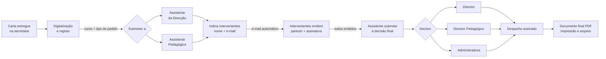

# Sistema de Gestão de Expedientes de Estudantes

Desenho funcional e técnico do circuito das cartas e requerimentos dos estudantes, desde a entrada na secretaria até ao despacho final.

Protótipo funcional: <https://claude.ai/artifact/5Jy2MYt89Gqum8VpKTfic8> (código em `sistema-expedientes/index.html`).

---

## 1. Problema que o sistema resolve

Hoje, numa faculdade típica em Moçambique, a carta de um estudante (por exemplo, um pedido de revisão de nota ou de prorrogação do pagamento de propinas) circula em papel de gabinete em gabinete. Isso traz quatro problemas:

1. **Não se sabe onde está o processo.** O estudante volta à secretaria várias vezes para perguntar.
2. **Os pareceres perdem-se ou atrasam.** Cada interveniente recebe a pasta física, e só um pode tê-la de cada vez.
3. **Não há prova de quem disse o quê e quando.** Rubricas à mão, sem data, são difíceis de verificar.
4. **Não há estatística.** A direcção não sabe quantos pedidos de cada tipo entram, nem quanto tempo levam.

O sistema digitaliza a carta à entrada e faz circular a cópia digital. Os pareceres são emitidos em paralelo, cada um com assinatura electrónica, e no fim gera-se um único documento para impressão e arquivo.

## 2. Actores (perfis)

| Perfil | Quem é | O que faz no sistema |
|---|---|---|
| **Secretaria** | Funcionário(a) da recepção | Recebe a carta, digitaliza, regista os dados, escolhe o curso e o tipo de pedido, submete a uma das assistentes |
| **Assistente da Direcção** | Assistente do Director / Administradora | Recebe os expedientes administrativos e financeiros, indica os intervenientes, notifica-os e submete à decisão |
| **Assistente Pedagógica** | Assistente do Director Pedagógico | O mesmo, para os expedientes pedagógicos (notas, exames, equivalências) |
| **Interveniente** | Director de curso, docente da cadeira, chefe do registo académico, tesouraria, etc. | Recebe e-mail, entra na plataforma, lê a carta, emite parecer e assina |
| **Decisor** | Director, Director Pedagógico ou Administradora | Lê o processo completo, decide (deferido / indeferido / deferido parcialmente), assina o despacho e imprime o documento final |

## 3. Fluxo do processo



### 3.1 Estados do expediente

| Estado | Entra quando | Sai quando |
|---|---|---|
| `recebido` | A secretaria regista e submete | A assistente encaminha a pelo menos um interveniente |
| `em_pareceres` | Há intervenientes notificados | Todos emitiram parecer **e** a assistente submete à decisão |
| `pronto_decisao` | Submetido ao decisor | O decisor assina o despacho |
| `decidido` | Despacho assinado | — (fica no arquivo) |

Regra principal: **o botão "Submeter à decisão final" só fica activo quando todos os pareceres estão emitidos.** A assistente pode acrescentar intervenientes enquanto o expediente está `em_pareceres`.

### 3.2 Passo a passo com um exemplo

> A estudante Amina Sitoe, do 3.º ano de Contabilidade e Auditoria, entrega uma carta a pedir revisão da nota do exame de Estatística II.

1. **Secretaria** — digitaliza a carta (PDF ou fotografia), preenche nome, nº de estudante, curso *Licenciatura em Contabilidade e Auditoria*, tipo *Revisão de nota / prova*, resumo do assunto. Escolhe **Assistente Pedagógica** e submete. O sistema atribui o número `EXP/2026/0001`.
2. **Assistente Pedagógica** — abre o expediente, vê a carta, e indica dois intervenientes: o Director do Curso e o docente da cadeira (nome, cargo, e-mail). Clica "Encaminhar e notificar". Cada um recebe um e-mail com o pedido e o endereço da plataforma.
3. **Intervenientes** — entram no separador *Pareceres* com o e-mail em que foram notificados, lêem a carta, escolhem o sentido (favorável / desfavorável / favorável com condições), escrevem a fundamentação, assinam com o rato ou o dedo e confirmam a autoria.
4. **Assistente Pedagógica** — vê os dois pareceres emitidos (2/2), escolhe o **Director Pedagógico**, confirma o e-mail e submete. O Director Pedagógico é notificado.
5. **Director Pedagógico** — lê todo o processo, escolhe *Deferido*, escreve o despacho, assina e descarrega o **documento final em PDF** para imprimir.

## 4. Componentes do protótipo

| Separador | Função |
|---|---|
| **Secretaria** | Formulário de registo, carregamento do scan, escolha da assistente, lista de todos os expedientes |
| **Assistentes** | Caixa de entrada por assistente; encaminhamento com nome, cargo e e-mail; submissão à decisão |
| **Pareceres** | Lista de pedidos dirigidos ao e-mail do interveniente; formulário de parecer com assinatura |
| **Decisão final** | Caixa por decisor; despacho com assinatura; descarga do PDF final |
| **Arquivo** | Pesquisa, totais, tempo médio até decisão, pedidos mais frequentes |

A faixa do topo mostra quantos expedientes estão em cada etapa e funciona como filtro.

## 5. Modelo de dados

```
expedientes/{id}
  ref               "EXP/2026/0001"
  estudante, numeroEstudante, contacto
  curso, tipoPedido, assunto, dataRecepcao, folhas
  scan              { assetId, url, nome, tipo }  ou  { inline: true, ... }
  assistente        "direcao" | "pedagogica"
  estado            "recebido" | "em_pareceres" | "pronto_decisao" | "decidido"
  decisor           "director" | "director_pedagogico" | "administradora"
  decisorNome, decisorEmail, submetidoDecisaoEm
  decisao           { sentido, texto, nome, assinatura(PNG), em, hash }
  historico[]       { em, acao, por }
  criadoEm, criadoPor

pareceres/{expId_n}
  expId, ordem, nome, cargo, email
  estado            "pendente" | "emitido"
  sentido           "favoravel" | "desfavoravel" | "condicionado"
  texto, assinatura(PNG), emitidoEm, hash
  solicitadoEm, solicitadoPor, notificacao ("enviado" | "manual")

digitalizacoes/{expId}   (só quando o armazenamento de ficheiros não está disponível)
  dataUrl, nome, tipo

config/geral
  instituicao, unidade
  emails { direcao, pedagogica, director, director_pedagogico, administradora }
  nomes  { ... }
```

Os pareceres ficam numa colecção própria (e não dentro do expediente) para que vários intervenientes possam assinar ao mesmo tempo sem se sobreporem.

## 6. Assinatura electrónica

No protótipo, cada assinatura junta três elementos:

1. **Assinatura manuscrita digital** — desenhada num quadro, guardada como imagem PNG.
2. **Identidade da conta** — o sistema regista a conta com que a pessoa entrou e exige a confirmação "Declaro que sou … e que este parecer é da minha autoria".
3. **Selo de integridade (SHA-256)** — calculado sobre o expediente, o e-mail, o sentido, o texto e a data/hora. O despacho final inclui também os selos de todos os pareceres. Se alguém alterar o texto depois, o selo deixa de corresponder.

Isto é uma **assinatura electrónica simples**. Para valor jurídico reforçado em Moçambique, a versão de produção deve integrar um certificado digital emitido por entidade certificadora credenciada, nos termos da Lei das Transacções Electrónicas (Lei n.º 3/2017, de 9 de Janeiro) e do regulamento da INTIC.

## 7. Notificações

- **Secretaria → Assistente**: e-mail automático ao submeter (se o e-mail da assistente estiver nas *Definições*).
- **Assistente → Intervenientes**: um e-mail por interveniente ao encaminhar.
- **Assistente → Decisor**: e-mail ao submeter à decisão.
- **Dentro da plataforma**: cada separador mostra um contador vermelho com o que está pendente para aquele perfil.

O protótipo envia os e-mails pela conta Gmail de quem está a usar a página (é pedida autorização uma vez). Se o envio automático não estiver disponível, o sistema mostra a mensagem pronta para copiar e enviar manualmente, e regista essa notificação como "manual".

## 8. Documento final

Gerado em PDF (A4), com:

1. Cabeçalho da instituição e número do expediente
2. Identificação do requerimento
3. Todos os pareceres, com sentido, fundamentação, assinatura, data e selo
4. Decisão final em carimbo (DEFERIDO / INDEFERIDO / DEFERIDO PARCIALMENTE), despacho, assinatura, nome e cargo do decisor
5. Anexo com a carta original digitalizada (quando é imagem)
6. Rodapé com número do expediente e paginação

## 9. Regras de negócio

1. O número do expediente é sequencial por ano: `EXP/AAAA/NNNN`.
2. Não se regista uma carta sem o ficheiro digitalizado.
3. Um parecer emitido não pode ser editado.
4. Só se submete à decisão quando todos os pareceres estão emitidos.
5. Cada interveniente vê apenas os pedidos dirigidos ao seu e-mail.
6. O despacho só pode ser assinado pelo decisor escolhido pela assistente.
7. Todas as acções ficam no histórico, com data, hora e autor.

## 10. Como pôr o protótipo a funcionar

1. Abra o protótipo e, como dono(a), clique em **Definições da instituição e contactos** (separador Secretaria). Preencha o nome da instituição e os nomes/e-mails das assistentes e decisores.
2. No menu **Partilhar** da página, dê acesso de **Contribuidor** à secretaria, às assistentes, aos intervenientes e aos decisores. Sem esse acesso, não conseguem abrir nem gravar.
3. Faça um teste completo com uma carta fictícia antes de usar com processos reais.

## 11. Passos para uma versão de produção

| Área | Protótipo | Produção recomendada |
|---|---|---|
| Autenticação | Conta claude.ai + escolha de separador | Login institucional (Google Workspace / Microsoft 365) com perfis fixos por utilizador |
| Permissões | Qualquer contribuidor vê tudo | Cada perfil só vê e faz o que lhe compete; intervenientes só os seus processos |
| Assinatura | Desenhada + SHA-256 | Certificado digital qualificado |
| Armazenamento | Base de dados do artefacto | Servidor da instituição (ex.: PostgreSQL + armazenamento de ficheiros), com cópias de segurança |
| Notificações | Gmail de quem usa | Servidor de e-mail institucional + SMS (Vodacom / Movitel / Tmcel) para o estudante |
| Estudante | Não acede | Portal para acompanhar o estado com o nº do expediente |
| Prazos | Não controlados | Prazo por tipo de pedido, alertas de atraso aos intervenientes |
| Integração | Isolado | Ligação ao sistema de gestão académica (dados do estudante preenchidos pelo nº) |
